# Preuves du TP CI · PokéWishlist

Dépôt : https://github.com/rparone2iim/pokemon-wishlist

Chaque étape a son commit (ou sa PR) sur `main`. Les étapes qui demandent une CI « rouge puis vert » passent par une PR : un commit casse volontairement la vérification, le suivant la corrige.

## Étape 1 · Setup

Projet Nuxt, dépôt GitHub et `.github/workflows/ci.yml`. Au premier push, le workflow apparaît dans l'onglet Actions.
Pipeline : https://github.com/rparone2iim/pokemon-wishlist/actions/runs/41602478072

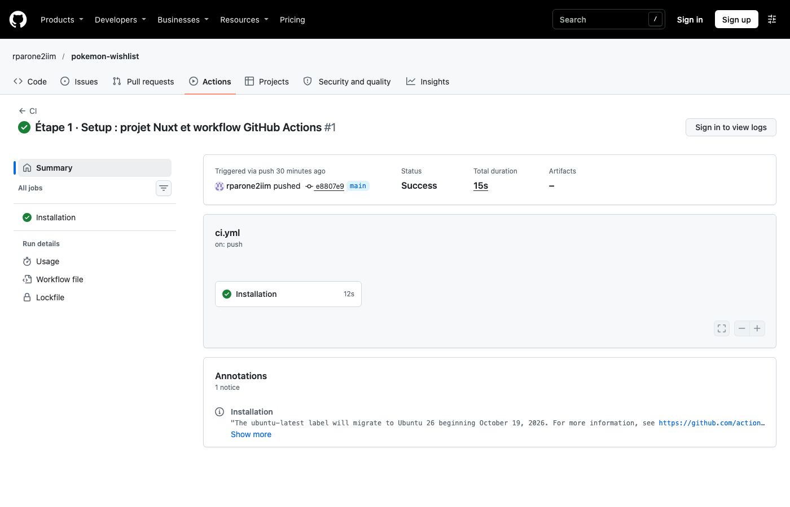

## Étape 2 · App

Recherche via PokéAPI, ajout et suppression, sauvegarde dans le `localStorage`. Pikachu est ajouté, la page est rechargée : il est toujours dans la wishlist (vérifié dans Chromium et WebKit).

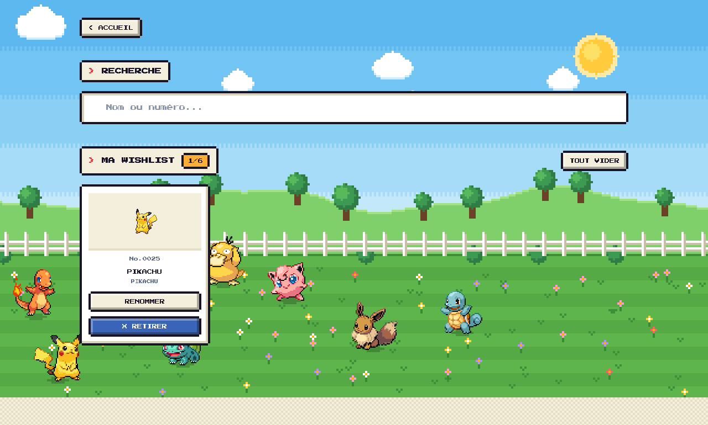

## Étape 3 · Lint

`@nuxt/eslint`, avec `no-console` et `no-debugger` en erreur. Un `console.log` est poussé : **Lint (ESLint)** rouge ; il est retiré : vert.
PR : https://github.com/rparone2iim/pokemon-wishlist/pull/1

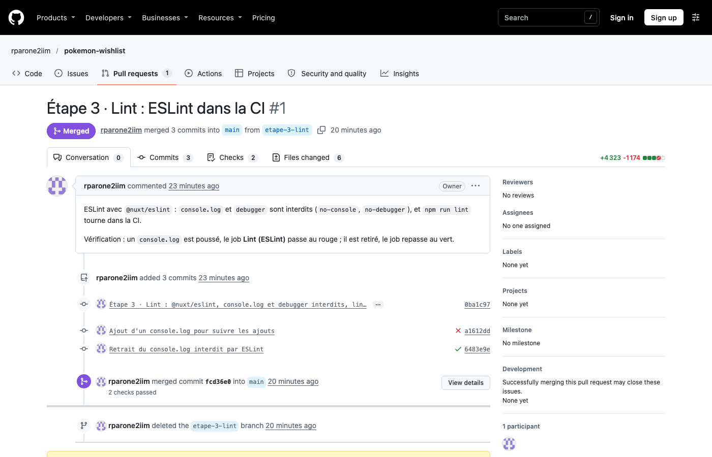

## Étape 4 · Format

Prettier (`singleQuote: true`, `semi: false`). Guillemets doubles et point-virgule poussés : `prettier --check` échoue, **Format (Prettier)** rouge ; après `npm run format` : vert.
PR : https://github.com/rparone2iim/pokemon-wishlist/pull/2

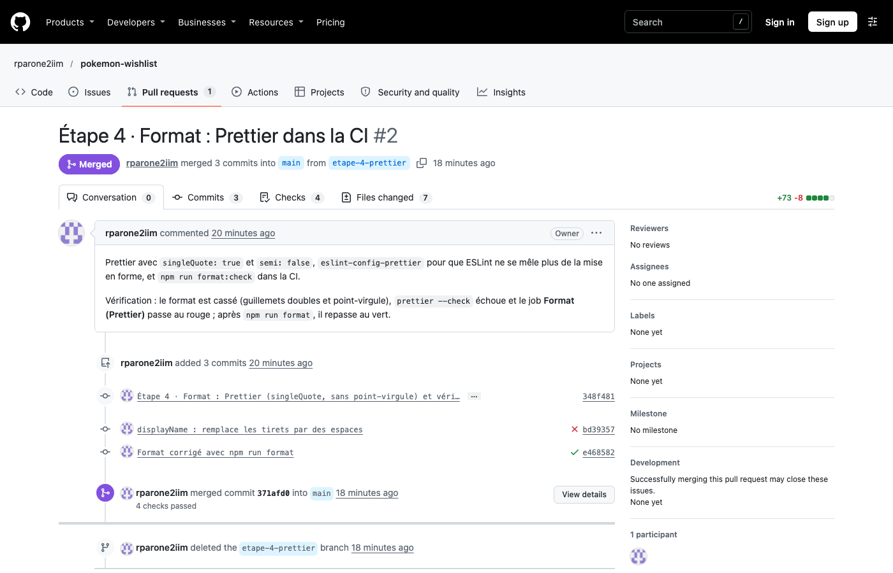

## Étape 5 · Types

Interfaces `Pokemon` et `WishlistItem` (`app/types/pokemon.ts`), fonctions et props typées. Un nombre rangé dans une variable `string` : `nuxt typecheck` échoue, **Typecheck (TypeScript)** rouge ; corrigé : vert.
PR : https://github.com/rparone2iim/pokemon-wishlist/pull/3

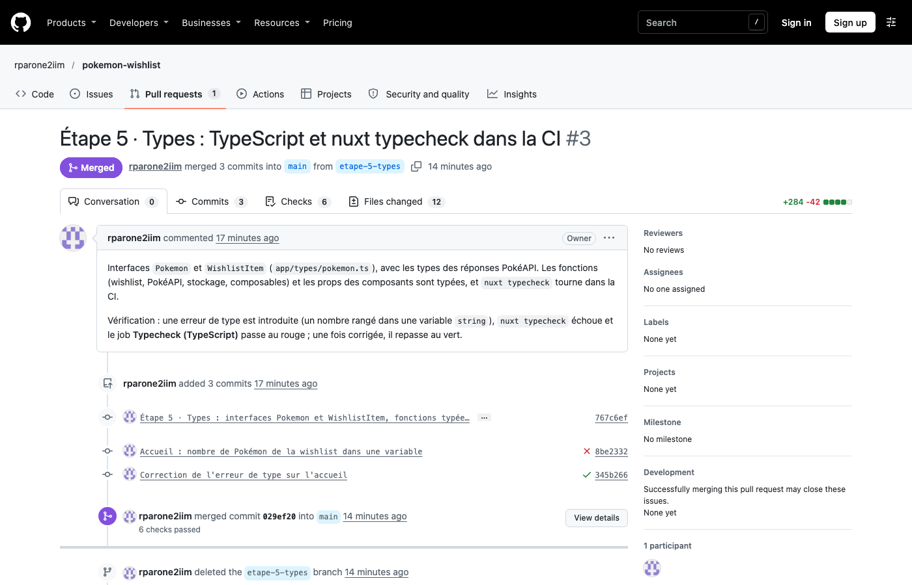

## Étape 6 · Unitaires

Tests Vitest de `addPokemon` : ajout, doublon, liste pleine (`test/wishlist.test.ts`). La règle est cassée (`>` au lieu de `>=`, un 7e Pokémon passe) : `vitest run` rouge ; rétablie : vert.
PR : https://github.com/rparone2iim/pokemon-wishlist/pull/4

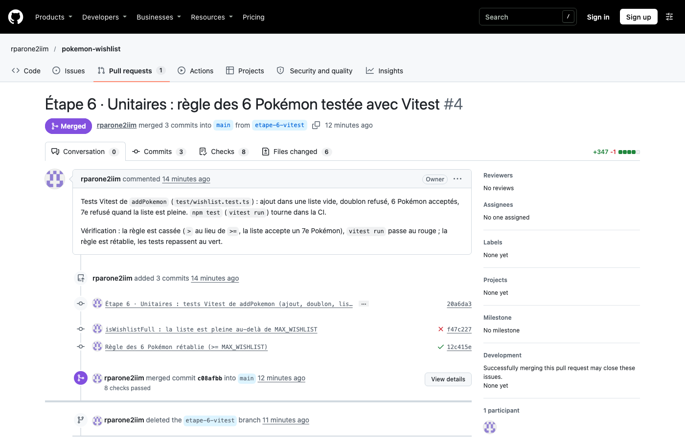

## Étape 7 · API

`fetch` est mocké dans `test/pokeapi.test.ts` : réponse 200, Pokémon introuvable (404), PokéAPI en panne (500). `test/setup.ts` fait échouer tout appel réseau non mocké.

Les tests passent même sans connexion : lancés dans un bac à sable macOS qui coupe tout le réseau, où un vrai `fetch` vers PokéAPI échoue en `EPERM`.

```text
$ sandbox-exec -p '(version 1)(allow default)(deny network-outbound (remote ip))' npx vitest run
 Test Files  2 passed (2)
      Tests  19 passed (19)
```

## Étape 8 · Stockage

Tests de la sauvegarde, de la lecture, du stockage vide, du JSON invalide, des entrées abîmées et d'un stockage plein ou inaccessible (`test/storage.test.ts`).

Écrits d'abord contre la première version du stockage (un simple `JSON.parse`), 6 tests sur 8 échouaient, et un JSON corrompu dans le `localStorage` faisait planter l'application :


Avec la lecture robuste (`app/utils/storage.ts`), les tests passent et le même JSON corrompu donne simplement une wishlist vide :

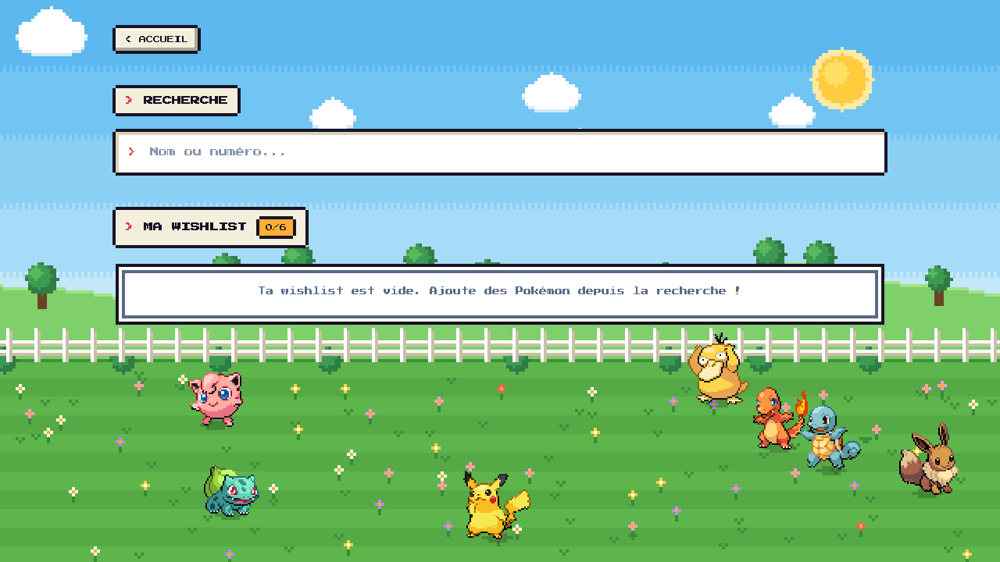

## Étape 9 · Build

`npm run build` dans la pipeline, après les contrôles. La page wishlist importe une feuille de style inexistante : le typecheck ne le voit pas, mais **Build (Nuxt)** est rouge ; l'import est retiré : vert.
PR : https://github.com/rparone2iim/pokemon-wishlist/pull/5

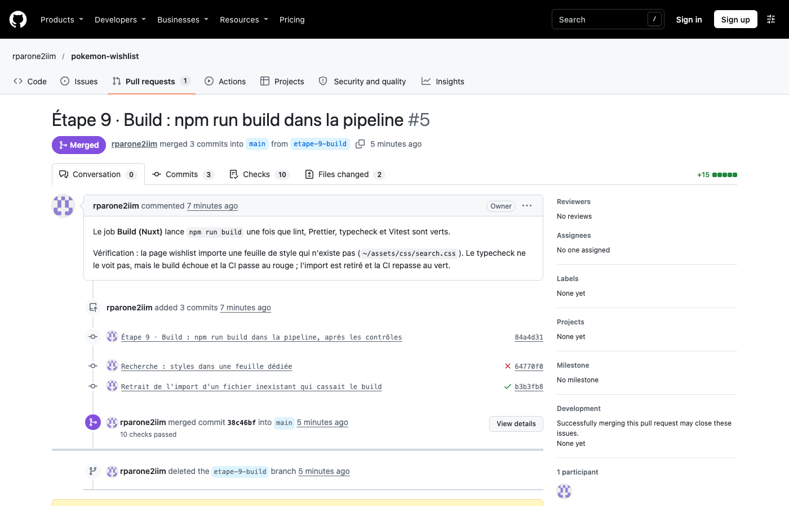

## Étape 10 · Actions

Un job par contrôle (lint, Prettier, typecheck, Vitest), puis le build. Chaque job fait `npm ci` via l'action commune `.github/actions/setup`.
Pipeline : https://github.com/rparone2iim/pokemon-wishlist/actions/runs/41605700746

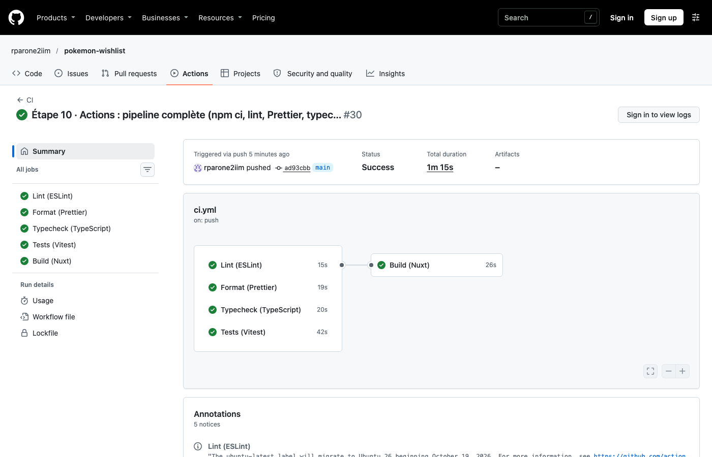

## Étape 11 · Validation

PR : https://github.com/rparone2iim/pokemon-wishlist/pull/6

1. Un `debugger` est laissé dans `addPokemon` : **Lint (ESLint)** échoue et le **Build** n'est pas lancé.
   Pipeline rouge : https://github.com/rparone2iim/pokemon-wishlist/actions/runs/41605903066

   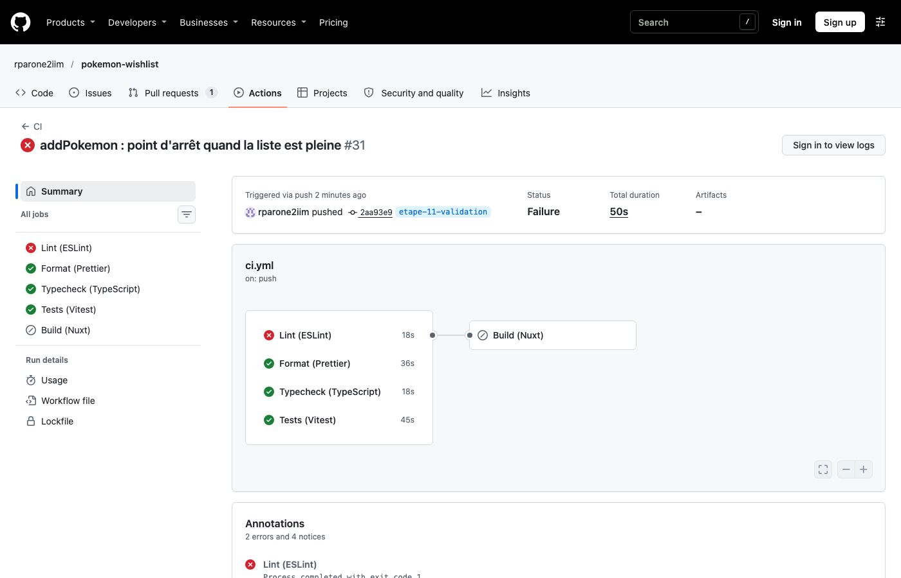

2. Le `debugger` est retiré et la branche est repoussée : les 5 contrôles passent au vert.
   Pipeline verte : https://github.com/rparone2iim/pokemon-wishlist/actions/runs/41606045366

   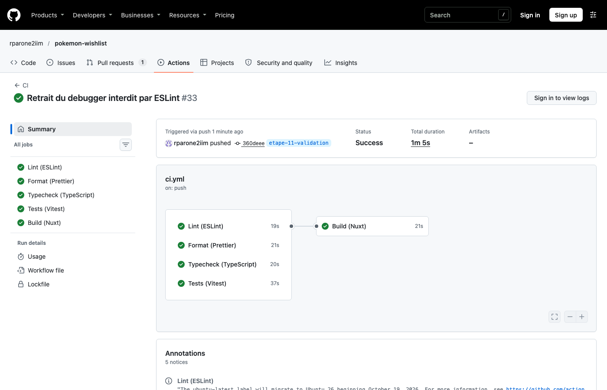

3. Sur la PR, le premier commit est rouge (✗) et le second vert (✓).

   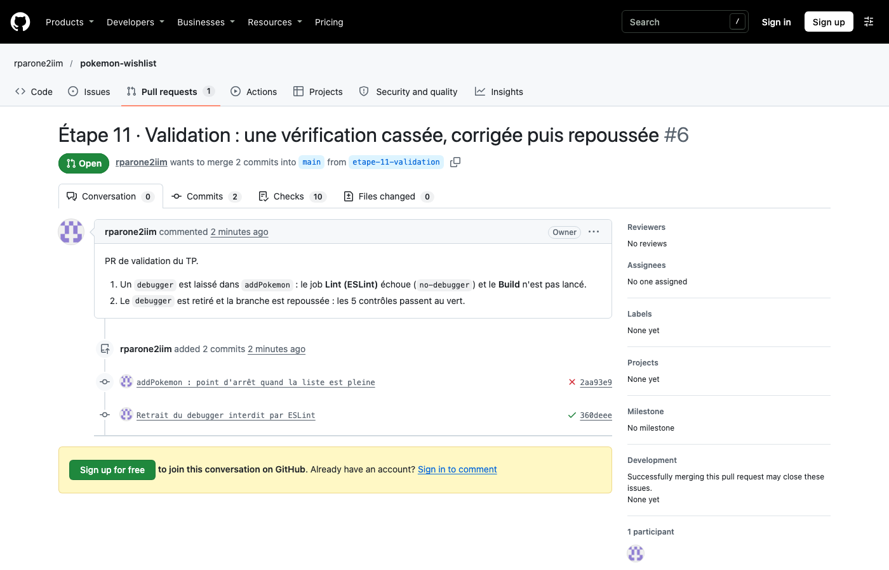

## Back · Setup · API Hono sans base de données

Monorepo npm workspaces : le front Nuxt passe dans `apps/web`, l'API Hono + TypeScript est dans `apps/api`. Dans la CI, le job **api · Build** compile l'API, la démarre et vérifie que `GET /health` renvoie 200.
Pipeline : https://github.com/rparone2iim/pokemon-wishlist/actions/runs/41606840672

```text
$ curl -i http://localhost:3001/health
HTTP/1.1 200 OK
{"status":"ok","service":"pokewishlist-api"}
```

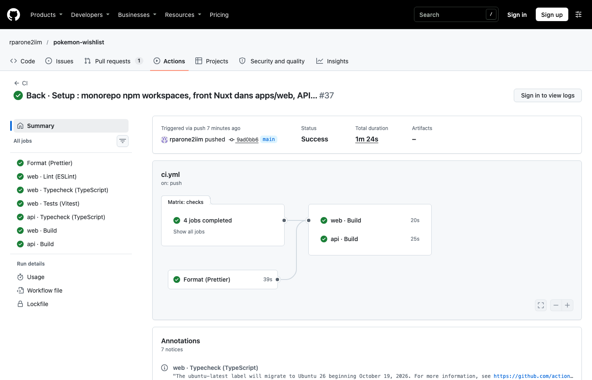

## Back · Routes · GET, POST et DELETE /wishlist

La wishlist est un tableau en mémoire (`apps/api/src/store.ts`). Les routes sont testées avec `app.request()`, sans démarrer de serveur (`apps/api/test/wishlist.test.ts`) :

```text
 ✓ test/health.test.ts > GET /health > renvoie 200 avec le statut ok
 ✓ test/health.test.ts > route inconnue > renvoie 404 en JSON
 ✓ test/wishlist.test.ts > GET /wishlist > renvoie 200 et une liste vide au départ
 ✓ test/wishlist.test.ts > GET /wishlist > renvoie 200 et les Pokémon ajoutés
 ✓ test/wishlist.test.ts > POST /wishlist > renvoie 201 et le Pokémon ajouté
 ✓ test/wishlist.test.ts > POST /wishlist > renvoie 409 pour un doublon
 ✓ test/wishlist.test.ts > POST /wishlist > renvoie 409 au-delà de 6 Pokémon
 ✓ test/wishlist.test.ts > POST /wishlist > renvoie 400 si le corps est invalide (JSON invalide)
 ✓ test/wishlist.test.ts > POST /wishlist > renvoie 400 si le corps est invalide (nom manquant)
 ✓ test/wishlist.test.ts > POST /wishlist > renvoie 400 si le corps est invalide (id pas un nombre)
 ✓ test/wishlist.test.ts > POST /wishlist > renvoie 400 si le corps est invalide (id négatif)
 ✓ test/wishlist.test.ts > POST /wishlist > renvoie 400 si le corps est invalide (nom vide)
 ✓ test/wishlist.test.ts > DELETE /wishlist/:id > renvoie 200 et retire le Pokémon
 ✓ test/wishlist.test.ts > DELETE /wishlist/:id > renvoie 404 si le Pokémon n’est pas dans la wishlist
 ✓ test/wishlist.test.ts > DELETE /wishlist/:id > renvoie 400 si l’identifiant est invalide
 ✓ test/wishlist.test.ts > mémoire > chaque app a sa propre wishlist
      Tests  16 passed (16)
```

## Back · CI · un `console.log` poussé dans l'API, rouge puis vert

PR : https://github.com/rparone2iim/pokemon-wishlist/pull/7

L'API a ESLint, Prettier, Vitest et ses scripts npm (`lint`, `format:check`, `typecheck`, `test`, `build`), lancés par `ci.yml`.

1. Un `console.log` est poussé dans l'API : **api · Lint (ESLint)** échoue (`no-console`) et les builds ne sont pas lancés.
   Pipeline rouge : https://github.com/rparone2iim/pokemon-wishlist/actions/runs/41607395049

   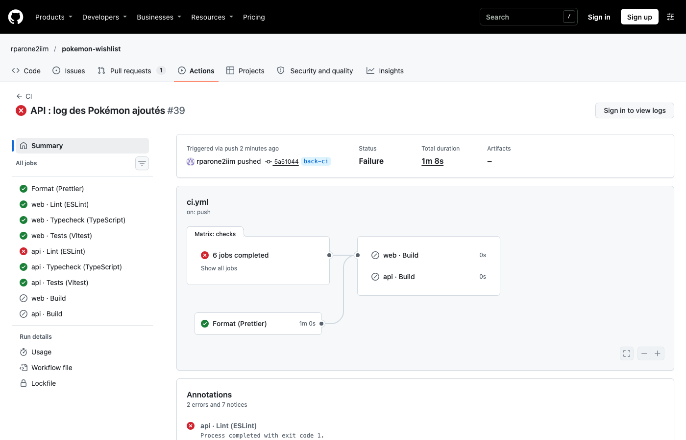

2. Le `console.log` est retiré : les 9 contrôles passent au vert.
   Pipeline verte : https://github.com/rparone2iim/pokemon-wishlist/actions/runs/41607584594

   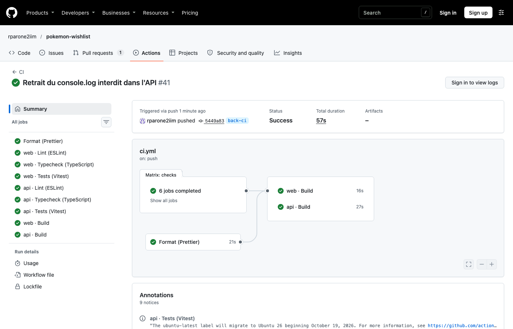

3. Sur la PR, le commit cassé est rouge (✗) et le suivant vert (✓).

   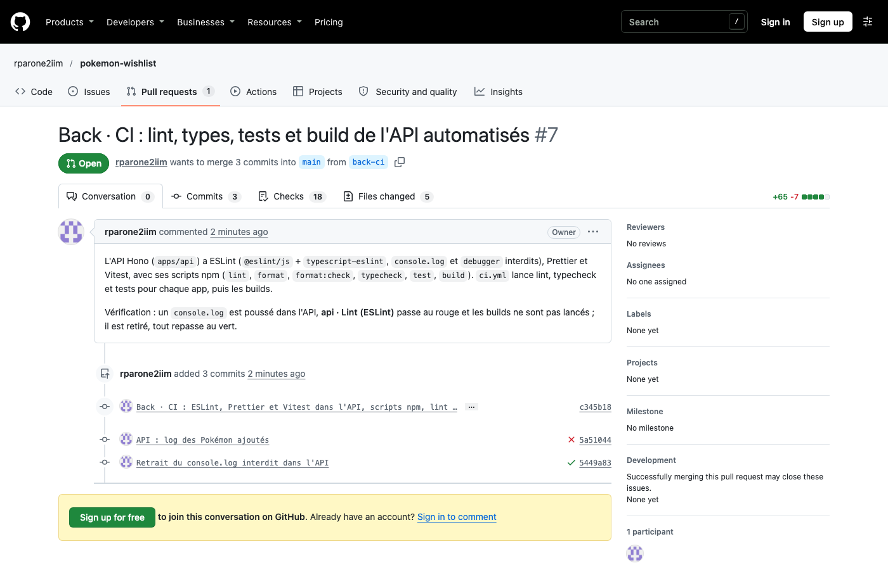

## Global · Connexion · Nuxt branché sur l'API Hono

Le front ne garde plus la wishlist lui-même : il appelle l'API Hono (`apps/web/app/utils/api.ts`).

| Action dans Nuxt      | Appel vers Hono                                                |
| --------------------- | -------------------------------------------------------------- |
| Ouvrir la wishlist    | `GET /wishlist`                                                |
| Ajouter un Pokémon    | `POST /wishlist`                                               |
| Retirer un Pokémon    | `DELETE /wishlist/:id`                                         |
| Renommer · Tout vider | `PATCH /wishlist/:id` · `DELETE /wishlist`                     |
| Chercher un Pokémon   | `GET /pokemon` · `GET /pokemon/:nom` (l'API interroge PokéAPI) |

Le `localStorage` n'est plus qu'un cache d'affichage (dernière liste connue si l'API ne répond pas) : la wishlist est celle de l'API.

Vérification (Chromium et WebKit) : wishlist de l'API vide, cache local vidé, puis Pikachu ajouté depuis Nuxt. Le front a appelé `GET /wishlist`, `GET /pokemon` puis `POST /wishlist`, et Pikachu apparaît dans `GET /wishlist` de l'API.

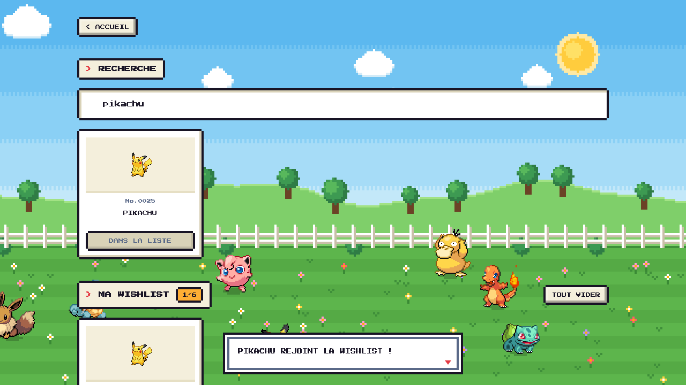

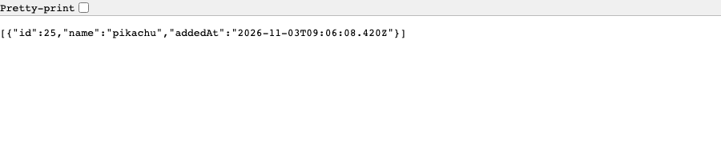

## Global · E2E · un parcours réel avec Playwright

`npm run test:e2e` démarre tout seul les serveurs (`apps/web/playwright.config.ts`) : une fausse PokéAPI, **l'API Hono (back)** et **le front Nuxt**, puis clique dans de vrais navigateurs (Chromium et WebKit).

Le parcours réel (`apps/web/e2e/parcours.spec.ts`), entièrement fait dans l'interface, vérifie aussi l'API à chaque étape :

1. **Ajout** : Pikachu est ajouté depuis la recherche et apparaît dans l'API.
2. **Doublon** : Pikachu ne peut pas être ajouté une 2e fois. Et si un autre client l'ajoute entre-temps, l'API répond `409` et le front l'affiche une seule fois.
3. **Limite de 6** : après 6 Pokémon, le 7e est refusé (« Liste pleine »), l'API en a toujours 6.
4. **Suppression** : Pikachu est retiré, une place se libère et le 7e peut être ajouté.

Un test vérifie aussi que le cache `localStorage` continue d'être sauvegardé quand on arrive sur la wishlist depuis l'accueil. Sans le correctif de `useWishlist`, ce test échoue dans les deux navigateurs.

Résultat : 36 tests sur 36 (18 scénarios × 2 navigateurs).

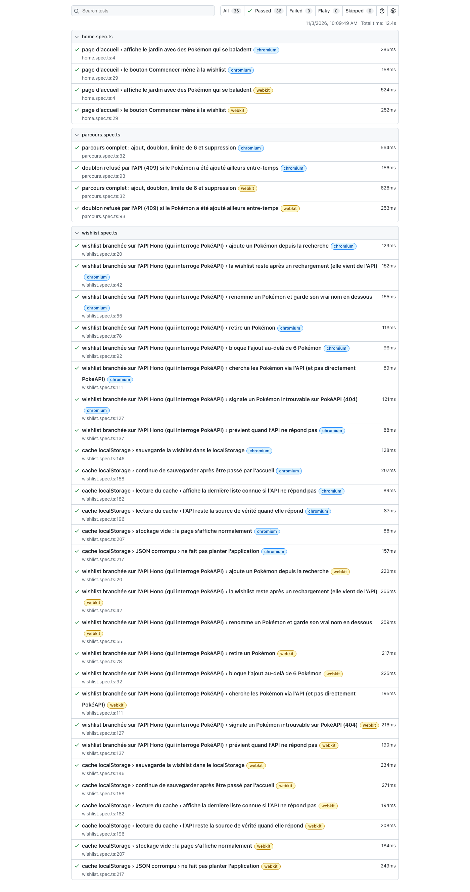

## Global · CI · les tests E2E dans GitHub Actions

Le job **web · Tests E2E (Playwright)** de `ci.yml` construit Hono et Nuxt, **les démarre** (avec une fausse PokéAPI), vérifie qu'ils répondent, puis lance Playwright sur ces serveurs. Il tourne en parallèle des autres contrôles.

PR : https://github.com/rparone2iim/pokemon-wishlist/pull/10

1. Réponse API cassée : `POST /wishlist` renvoie `200` au lieu de `201`. Les trois serveurs démarrent bien, mais le front ne reconnaît plus la réponse et l'ajout échoue : **E2E rouge**, 12 tests en échec sur 36 (tous ceux qui ajoutent un Pokémon). Les tests unitaires de l'API échouent aussi.
   Pipeline rouge : https://github.com/rparone2iim/pokemon-wishlist/actions/runs/41609376335

   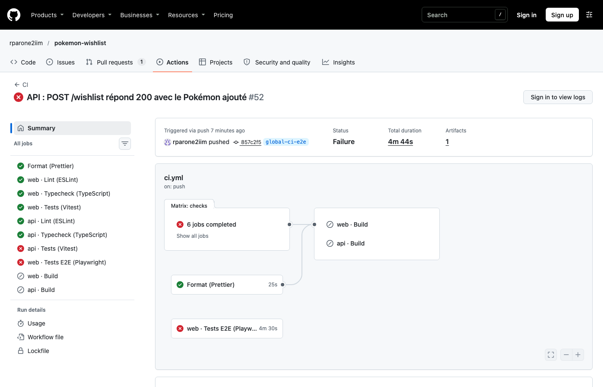

2. Réponse corrigée (`201`) : **E2E vert**, 36 tests sur 36, toute la pipeline est verte.
   Pipeline verte : https://github.com/rparone2iim/pokemon-wishlist/actions/runs/41610121015

   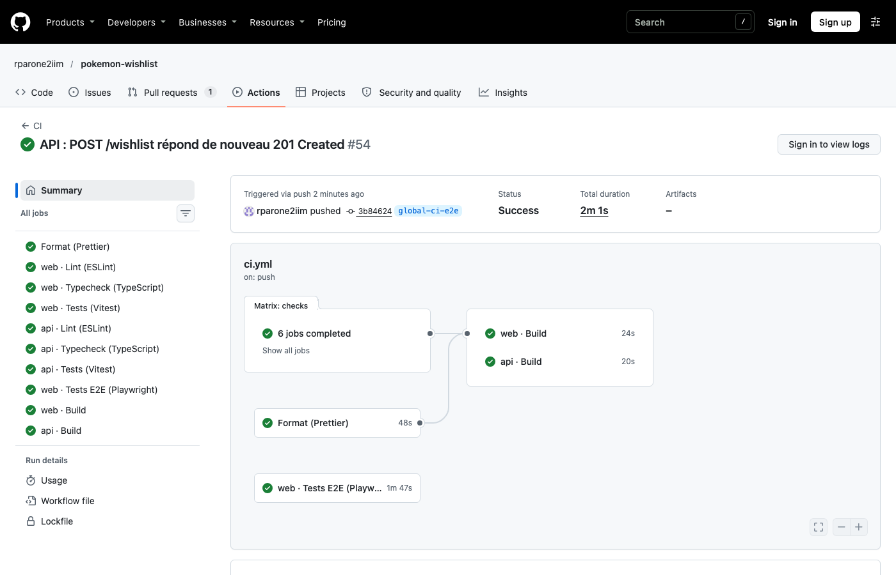

3. Sur la PR, le commit cassé est rouge (✗) et le suivant vert (✓).

   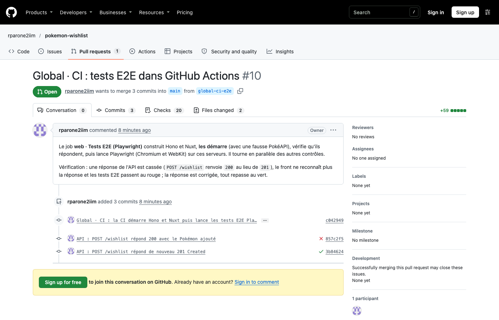

## BDD · Initialisation · les tables avec `init.sql`

Projet Supabase `pokemon-wishlist` (région Paris, `eu-west-3`, PostgreSQL 17). Le schéma est dans `apps/api/db/init.sql` et a été exécuté sur Supabase avec `psql`. Le script peut être relancé : il ne recrée que ce qui manque.

```text
$ psql "$DATABASE_URL" -v ON_ERROR_STOP=1 -f apps/api/db/init.sql
$ psql "$DATABASE_URL" -c '\d public.wishlist'
                            Table « public.wishlist »
  Colonne   |           Type           | Collationnement | NULL-able | Par défaut
------------+--------------------------+-----------------+-----------+------------
 pokemon_id | integer                  |                 | not null  |
 name       | text                     |                 | not null  |
 nickname   | text                     |                 |           |
 added_at   | timestamp with time zone |                 | not null  | now()
Index :
    "wishlist_pkey" PRIMARY KEY, btree (pokemon_id)
    "wishlist_added_at_idx" btree (added_at)
Contraintes de vérification :
    "wishlist_name_check" CHECK (length(TRIM(BOTH FROM name)) > 0)
    "wishlist_nickname_check" CHECK (nickname IS NULL OR length(nickname) >= 1 AND length(nickname) <= 12)
    "wishlist_pokemon_id_check" CHECK (pokemon_id > 0)
Politiques (mode sécurité de ligne activé) : (aucune)
Triggers :
    wishlist_max_6 BEFORE INSERT ON wishlist FOR EACH ROW EXECUTE FUNCTION wishlist_max_6()
```

La table est aussi consultable via l'API de Supabase (`supabase db query --remote=<ref> --read-only "select … from information_schema.columns where table_name = 'wishlist'"`), qui renvoie les colonnes `pokemon_id`, `name`, `nickname` et `added_at`.

- **Doublon** : refusé par la clé primaire (`23505`).
- **Limite de 6** : refusée par le trigger `wishlist_max_6` (`23514`), même si plusieurs ajouts arrivent en même temps (verrou de transaction).
- **RLS activé** sans politique : l'API REST publique de Supabase ne peut pas lire la table, seule l'API Hono (rôle propriétaire) y accède.

## Back · Persistance · Hono branché sur PostgreSQL

Le tableau en mémoire est remplacé par `apps/api/src/pg-store.ts` : chaque route fait une requête SQL **paramétrée** (`$1`, `$2`…, jamais de valeur concaténée dans le SQL) sur la base Supabase de `DATABASE_URL`. Doublons et limite de 6 sont refusés par la base (clé primaire, trigger) et renvoyés en `409` comme avant : le front n'a pas changé.

Vérification sur Supabase : des Pokémon sont ajoutés et renommés, l'API est arrêtée puis relancée, et ils sont toujours là.

```text
$ curl -s -X DELETE -o /dev/null -w '%{http_code}' localhost:3001/wishlist
204
$ curl -s -X POST localhost:3001/wishlist -H 'content-type: application/json' -d '{"id":25,"name":"pikachu"}'
{"id":25,"name":"pikachu","addedAt":"2026-11-03T10:46:55.396Z"}
$ curl -s -X POST localhost:3001/wishlist -H 'content-type: application/json' -d '{"id":133,"name":"eevee"}'
{"id":133,"name":"eevee","addedAt":"2026-11-03T10:46:55.419Z"}
$ curl -s -X PATCH localhost:3001/wishlist/133 -H 'content-type: application/json' -d '{"nickname":"Evoli"}'
{"id":133,"name":"eevee","addedAt":"2026-11-03T10:46:55.419Z","nickname":"Evoli"}
$ curl -s localhost:3001/wishlist
[{"id":25,"name":"pikachu","addedAt":"2026-11-03T10:46:55.396Z"},{"id":133,"name":"eevee","addedAt":"2026-11-03T10:46:55.419Z","nickname":"Evoli"}]
# --- redémarrage de l API ---
$ curl -s localhost:3001/wishlist
[{"id":25,"name":"pikachu","addedAt":"2026-11-03T10:46:55.396Z"},{"id":133,"name":"eevee","addedAt":"2026-11-03T10:46:55.419Z","nickname":"Evoli"}]
```

Doublon et limite de 6 sur Supabase : Pikachu une 2e fois → `409`, puis 4 ajouts → `201`, le 7e → `409` « La wishlist est pleine (6 max) ». Les lignes, lues dans Supabase (`supabase db query --remote`) :

```text
Target: project pokemon-wishlist (ytfawkbkumvlqjbesptk) · production
┌────────────┬────────────┬──────────┐
│ pokemon_id │ name       │ nickname │
├────────────┼────────────┼──────────┤
│ 25         │ pikachu    │ NULL     │
│ 133        │ eevee      │ Evoli    │
│ 1          │ bulbasaur  │ NULL     │
│ 4          │ charmander │ NULL     │
│ 7          │ squirtle   │ NULL     │
│ 39         │ jigglypuff │ NULL     │
└────────────┴────────────┴──────────┘
```

Les 36 tests E2E passent aussi sur un vrai PostgreSQL (base dédiée en local, conteneur dans la CI).

## Back · Intégration · les routes testées sur une vraie BDD

Les tests de routes (`apps/api/test/wishlist.test.ts`) tournent sur une **vraie base PostgreSQL de test**, isolée de Supabase. Il n'y a plus ni tableau en mémoire ni mock SQL.

- **Base isolée** : `TEST_DATABASE_URL` (en local `pokewishlist_test`, dans la CI un conteneur `postgres:17`). Vitest la crée si besoin et y applique `db/init.sql` (`test/global-setup.ts`).
- **Données nettoyées** : la table est vidée avant chaque test (`truncate`) et à la fin de la suite.
- **Garde-fou** : les tests refusent de tourner sur Supabase ou sur une base dont le nom ne contient pas « test ».

Chaque test vérifie la réponse HTTP et aussi le contenu réel de la table, lu en SQL :

```text
 ✓ test/wishlist.test.ts > GET /wishlist > renvoie 200 et une liste vide au départ
 ✓ test/wishlist.test.ts > GET /wishlist > renvoie 200 et les Pokémon ajoutés
 ✓ test/wishlist.test.ts > POST /wishlist > renvoie 201 et le Pokémon ajouté
 ✓ test/wishlist.test.ts > POST /wishlist > renvoie 409 pour un doublon
 ✓ test/wishlist.test.ts > POST /wishlist > renvoie 409 au-delà de 6 Pokémon
 ✓ test/wishlist.test.ts > POST /wishlist > garde la limite de 6 même avec 10 ajouts en même temps
 ✓ test/wishlist.test.ts > POST /wishlist > renvoie 400 si le corps est invalide (JSON invalide)
 ✓ test/wishlist.test.ts > POST /wishlist > renvoie 400 si le corps est invalide (nom manquant)
 ✓ test/wishlist.test.ts > POST /wishlist > renvoie 400 si le corps est invalide (id pas un nombre)
 ✓ test/wishlist.test.ts > POST /wishlist > renvoie 400 si le corps est invalide (id négatif)
 ✓ test/wishlist.test.ts > POST /wishlist > renvoie 400 si le corps est invalide (nom vide)
 ✓ test/wishlist.test.ts > DELETE /wishlist/:id > renvoie 200 et retire le Pokémon
 ✓ test/wishlist.test.ts > DELETE /wishlist/:id > renvoie 404 si le Pokémon n’est pas dans la wishlist
 ✓ test/wishlist.test.ts > DELETE /wishlist/:id > renvoie 400 si l’identifiant est invalide
 ✓ test/wishlist.test.ts > DELETE /wishlist > renvoie 204 et vide la wishlist
 ✓ test/wishlist.test.ts > PATCH /wishlist/:id > renvoie 200 et donne un surnom
 ✓ test/wishlist.test.ts > PATCH /wishlist/:id > coupe le surnom à 12 caractères
 ✓ test/wishlist.test.ts > PATCH /wishlist/:id > retire le surnom s’il est vide ou identique au vrai nom
 ✓ test/wishlist.test.ts > PATCH /wishlist/:id > renvoie 404 si le Pokémon n’est pas dans la wishlist
 ✓ test/wishlist.test.ts > PATCH /wishlist/:id > renvoie 400 si le corps ou l’identifiant est invalide
 ✓ test/wishlist.test.ts > CORS > autorise le front à appeler l’API
 ✓ test/wishlist.test.ts > CORS > n’autorise pas une origine inconnue
 ✓ test/wishlist.test.ts > persistance > une nouvelle instance de l’API retrouve la wishlist (comme après un redémarrage)
      Tests  37 passed (37)
```

Sans base de données, les tests échouent : ils parlent bien à PostgreSQL.

```text
$ TEST_DATABASE_URL=postgresql://localhost:5999/pokewishlist_test npm test -w apps/api
Error: connect ECONNREFUSED ::1:5999
```

Et ils refusent de toucher à Supabase :

```text
$ TEST_DATABASE_URL=postgresql://…@aws-1-eu-west-3.pooler.supabase.com:5432/postgres npm test -w apps/api
Error: Tests refusés sur aws-1-eu-west-3.pooler.supabase.com/postgres : il faut une base de test (nom contenant « test »)
```

Dans la CI, le job **api · Tests (Vitest + PostgreSQL)** lance ces tests sur son propre conteneur PostgreSQL.
Pipeline : https://github.com/rparone2iim/pokemon-wishlist/actions/runs/41623145266

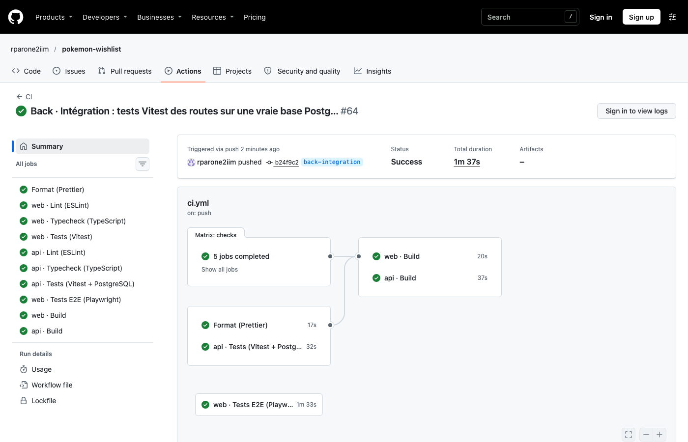

## Front · Route dynamique · la fiche `/pokemon/[name]`

La page `apps/web/app/pages/pokemon/[name].vue` affiche la fiche d'un Pokémon à partir de PokéAPI, toujours via l'API Hono (`GET /pokemon/:nom`). L'API combine deux réponses de PokéAPI, le Pokémon et son espèce, et garde les fiches en cache. La fiche montre le nom français, le numéro, la catégorie, les types, la description du Pokédex, la taille, le poids, les talents et les statistiques. On peut ajouter le Pokémon à la wishlist depuis la fiche, et l'ouvrir en cliquant sur l'image d'une carte.

Vérification : une URL directe affiche le Pokémon et ses informations (Chromium et WebKit, vraie PokéAPI).

`http://localhost:3000/pokemon/pikachu`

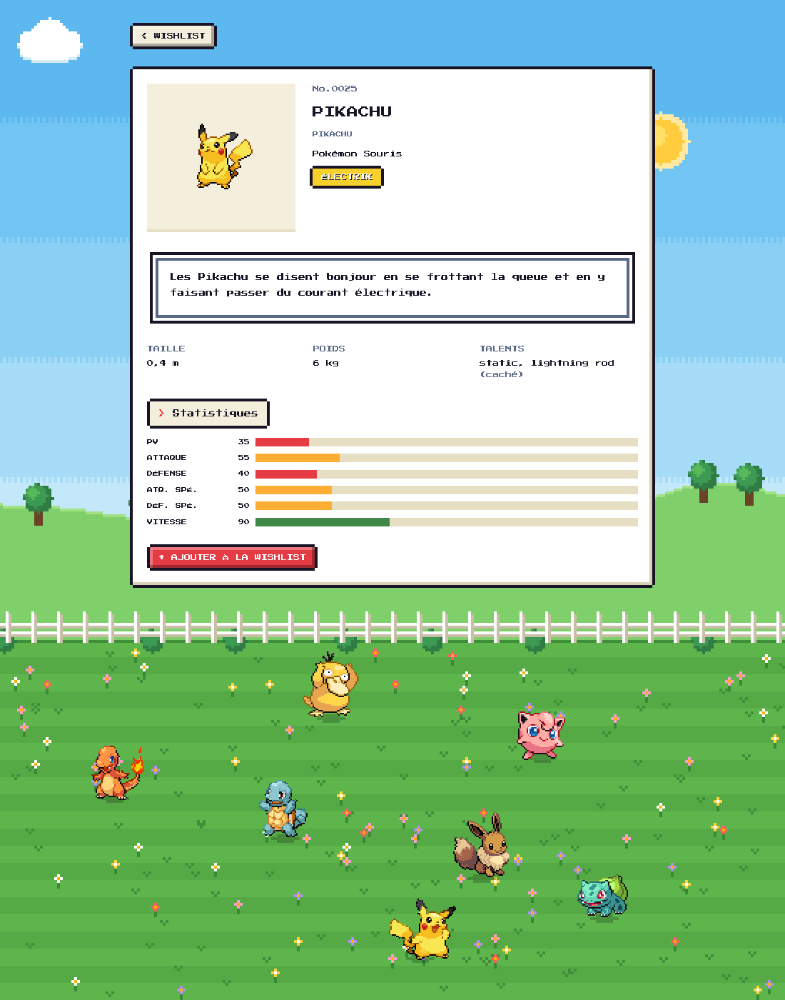

`http://localhost:3000/pokemon/charizard` (nom français, deux types)

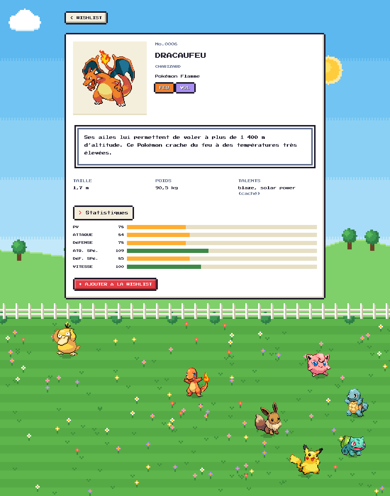

Cas 404 : `http://localhost:3000/pokemon/pikachoux`

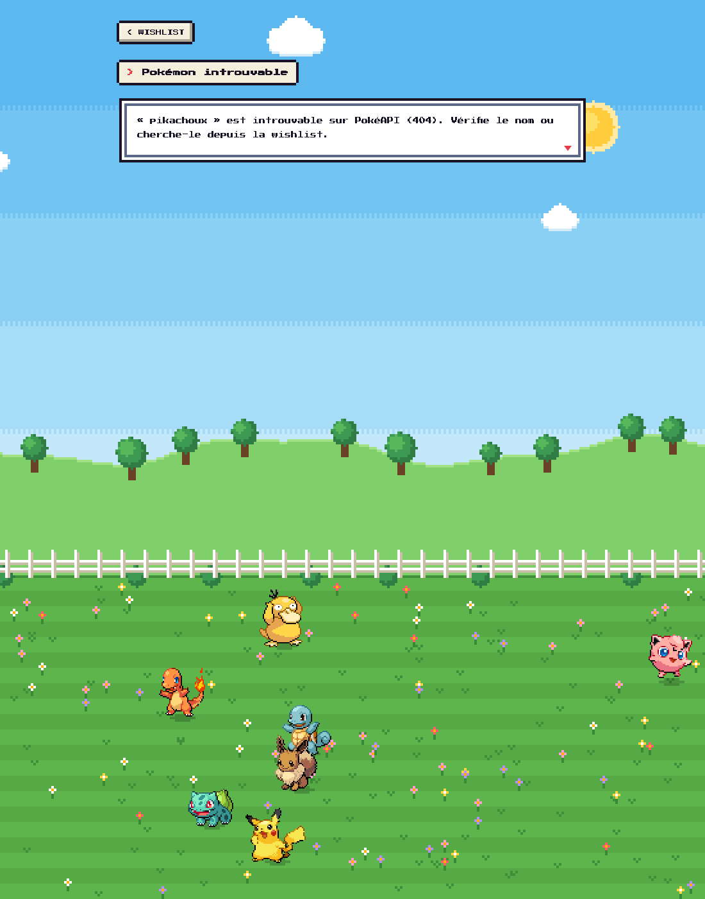

Tests E2E (`apps/web/e2e/pokemon.spec.ts`, 7 scénarios × 2 navigateurs) : URL directe avec toutes les informations, nom français et deux types, numéro ou majuscules dans l'URL, 404, nom invalide, ouverture depuis une carte de la wishlist, ajout depuis la fiche. La suite complète passe : 50 tests sur 50. Répétée 8 fois, la nouvelle suite donne 112 sur 112.

## Front + Back · i18n · quatre langues

- **Front** : `apps/web/i18n/locales/en.json`, `fr.json`, `es.json`, `de.json` (67 clés chacun). Toute l'interface passe par `t('…')` : pages, cartes, messages, types et statistiques des fiches, format des nombres (`0.4 m` / `0,4 m`). Sélecteur EN · FR · ES · DE en haut à droite, langue gardée dans le navigateur, `<html lang>` à jour.
- **Back** : `apps/api/src/locales/en.json`, `fr.json`, `es.json`, `de.json`. Toutes les erreurs de Hono sont traduites ; la langue vient de `?lang=` ou de `Accept-Language` (middleware `languageDetector` de Hono).
- **Anglais par défaut**, même avec un navigateur réglé en français.

Vérification : changer de langue modifie l'UI et un message de l'API. Sur `/pokemon/pikachoux`, le titre et l'aide viennent du front, et « Pokémon not found » vient de l'API (404). En changeant de langue, le front redemande la fiche avec le nouvel `Accept-Language`, et les deux changent.

```text
$ curl -H 'Accept-Language: en' localhost:3001/pokemon/pikachoux
{"error":"Pokémon not found"}
$ curl -H 'Accept-Language: fr' localhost:3001/pokemon/pikachoux
{"error":"Pokémon introuvable"}
$ curl -H 'Accept-Language: es' localhost:3001/pokemon/pikachoux
{"error":"Pokémon no encontrado"}
$ curl -H 'Accept-Language: de' localhost:3001/pokemon/pikachoux
{"error":"Pokémon nicht gefunden"}
```

Anglais (par défaut), puis français :

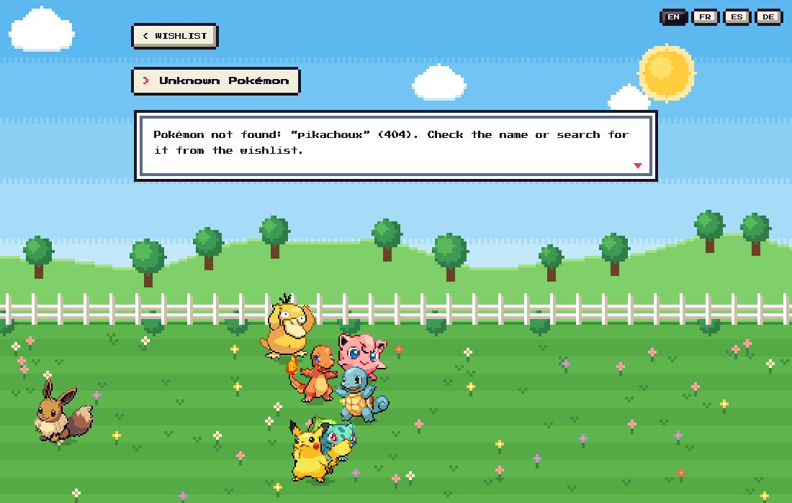

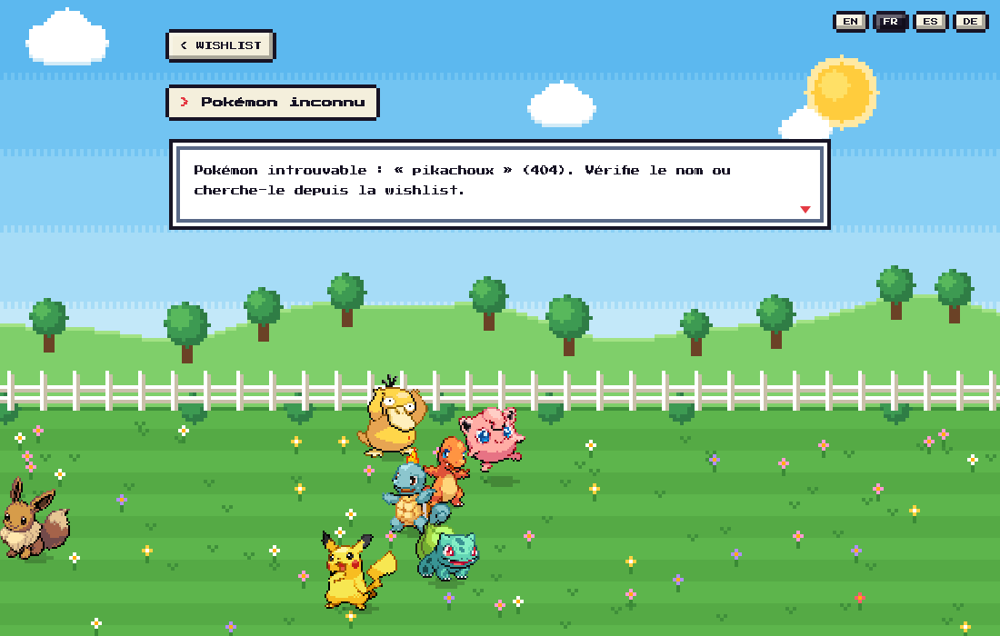

Fiche en espagnol (nom, catégorie, description et types traduits) et wishlist en allemand :

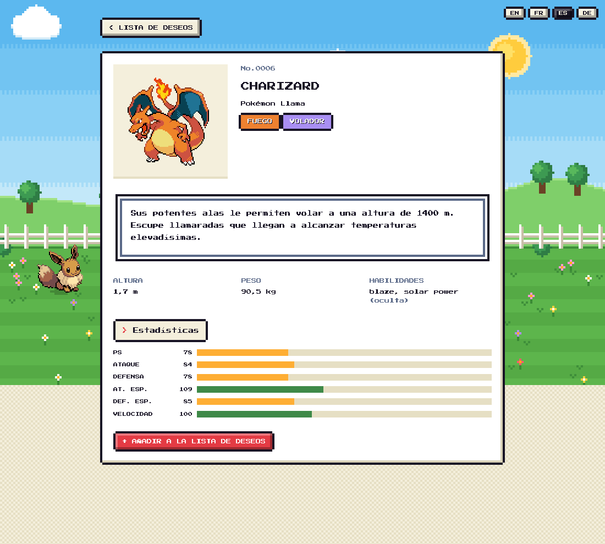

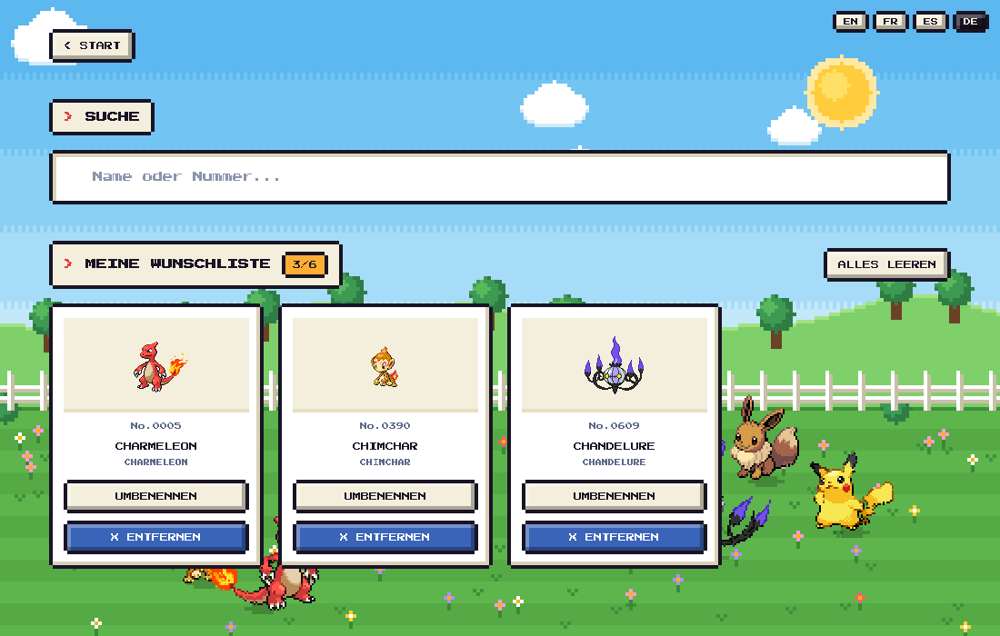

Tests :

- **API** : `test/i18n.test.ts`, les erreurs dans les 4 langues, `Accept-Language` d'un navigateur, `?lang=`, langue inconnue ramenée à l'anglais, message avec paramètre.
- **Front** : `test/i18n.test.ts`, traduction, paramètres, langue gardée.
- **E2E** : `e2e/i18n.spec.ts`, 6 scénarios × 2 navigateurs : anglais par défaut, l'UI dans les 4 langues, le message 404 de l'API qui change avec la langue (et l'`Accept-Language` envoyé), le refus 409 de l'API en allemand, la fiche traduite, la langue gardée après rechargement. La suite complète passe : 62 tests sur 62.
